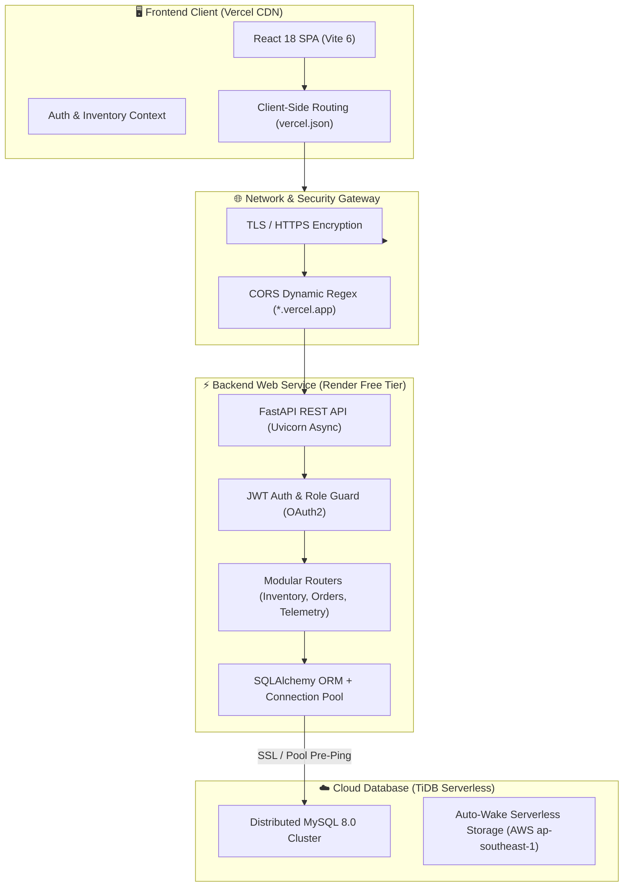
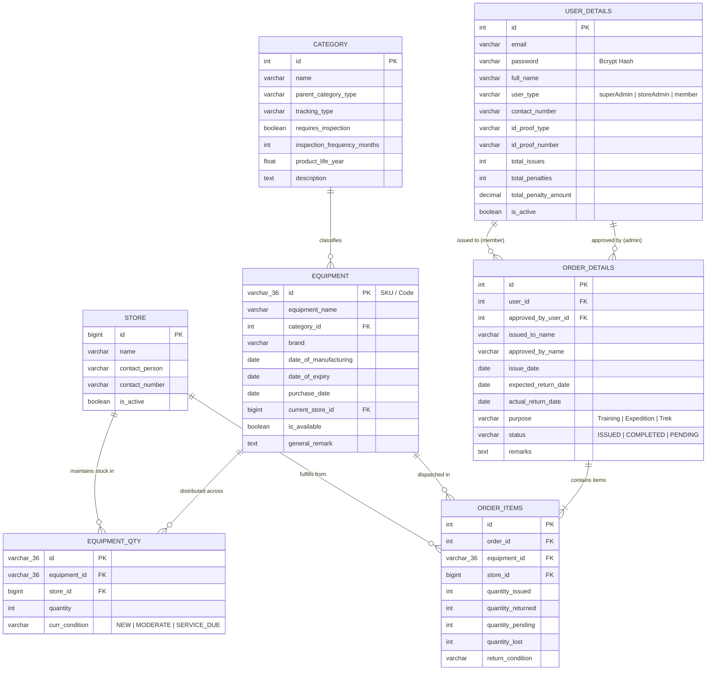

# 🏔️ GiriPremi — Expedition Equipment & Inventory Management System

<p align="center">
  
  
  
  
  
  
  
  
  
</p>

<p align="center">
  <strong>Mission-critical inventory, multi-store allocation, and equipment lifecycle tracking engineered for the pioneer mountaineering expeditions of GiriPremi.</strong>
</p>

---

## 📌 Overview

**GiriPremi IMS** is a production-grade, full-stack inventory and gear-management platform designed for mountaineering, trekking, and search-and-rescue organizations. It provides real-time multi-depot stock allocation, barcode/SKU tracking, lifecycle and condition audits, automated safety inspections, and member equipment dispatch/return workflows with complete audit trails.

---

## 🏗️ System Architecture



---

## 🗄️ Database Entity-Relationship (ER) Diagram



---

## 🎨 Tech Stack Matrix

| Domain | Technology | Purpose |
| :--- | :--- | :--- |
| **Frontend Framework** | **React 18 + Vite 6** | High-performance SPA with fast HMR |
| **Styling & UX** | **Vanilla CSS + Material Symbols** | Premium dark-mode alpine aesthetics, responsive layouts, glassmorphism |
| **Backend Framework** | **FastAPI (Python 3.12)** | Asynchronous, type-safe REST API endpoints |
| **Database & ORM** | **SQLAlchemy + PyMySQL** | Relational mapping, connection resilience (`pool_pre_ping`, `pool_recycle`) |
| **Cloud Database** | **TiDB Cloud Serverless** | Scalable, auto-waking MySQL 8.0-compatible distributed cloud cluster |
| **Security & Auth** | **JWT (python-jose) + Passlib (Bcrypt)** | Stateless token-based role-based access control (RBAC) |
| **Frontend Hosting** | **Vercel** | Global edge network with zero-config single page app rewrites |
| **Backend Hosting** | **Render (Web Service)** | Containerized Linux cloud runner for Python/Uvicorn |

---

## ✨ Core Features

- 📊 **Executive Telemetry Dashboard**: Real-time metrics for available gear, active dispatches, category share distributions, and dynamic safety compliance health bars.
- 🏬 **Multi-Depot Inventory Engine**: Track physical inventory balances across HQ, regional depots, and forward high-altitude base camps.
- 🎒 **Issue & Return Dispatch Console**: Full checkout workflow with member identity verification, purpose logging, expected return timelines, and condition assessments upon check-in.
- 🔍 **Safety Health & Inspection Alerts**: Automated calculation of approaching expiry dates (within 48 days) for ropes, helmets, harnesses, and alpine hardware.
- 📁 **Excel Import / Export**: Bulk-upload equipment catalog and category trees with schema validation.
- 🛡️ **Role-Based Security**: Segregated interfaces and access rules for **Super Admins**, **Store Managers**, and **Expedition Members**.

---

## 🚀 Local Development Setup

### Prerequisites
- **Python 3.10+** (Python 3.12 recommended)
- **Node.js 18+** & **npm**
- **MySQL 8.0** or **TiDB Cloud Serverless** connection

---

### 1. Backend Setup

```bash
# Navigate to backend
cd backend

# Create and activate virtual environment
python -m venv venv
venv\Scripts\activate       # Windows
# source venv/bin/activate  # macOS / Linux

# Install dependencies
pip install -r requirements.txt

# Create your .env file
cp .env.example .env
```

Configure `backend/.env`:
```env
DATABASE_URL=mysql+pymysql://<user>:<password>@<host>:<port>/<dbname>
SECRET_KEY=your-custom-jwt-secret-key-32-chars
ALGORITHM=HS256
ACCESS_TOKEN_EXPIRE_MINUTES=480
FRONTEND_ORIGINS=http://localhost:5173
```

Run the backend server:
```bash
uvicorn app.main:app --reload
```
API Documentation will be live at: [http://localhost:8000/docs](http://localhost:8000/docs)

---

### 2. Frontend Setup

```bash
# Navigate to frontend
cd frontend

# Install packages
npm install

# Create environment file
cp .env.example .env
```

Configure `frontend/.env`:
```env
VITE_API_BASE_URL=http://localhost:8000
```

Start the Vite development server:
```bash
npm run dev
```
Open [http://localhost:5173](http://localhost:5173) in your browser.

---

## 🌐 Production Deployment Guide

### A. Deploy Backend on Render
1. Create a **New Web Service** from your GitHub repo.
2. Settings:
   - **Root Directory:** `backend`
   - **Runtime:** `Python 3`
   - **Build Command:** `pip install -r requirements.txt`
   - **Start Command:** `uvicorn app.main:app --host 0.0.0.0 --port $PORT`
3. Environment Variables:
   - `DATABASE_URL`: `mysql+pymysql://<user>:<password>@<host>:4000/giripremi`
   - `SECRET_KEY`: `giripremi-super-secret-jwt-key-change-in-production-2024`
   - `ALGORITHM`: `HS256`
   - `ACCESS_TOKEN_EXPIRE_MINUTES`: `480`
   - `FRONTEND_ORIGINS`: `http://localhost:5173` *(Vercel production and preview subdomains are auto-allowed by dynamic CORS regex)*

### B. Deploy Frontend on Vercel
1. Import repository into Vercel.
2. Settings:
   - **Framework Preset:** `Vite`
   - **Root Directory:** `frontend`
   - **Build Command:** `npm run build`
   - **Output Directory:** `dist`
3. Environment Variables:
   - `VITE_API_BASE_URL`: `https://your-render-backend.onrender.com` *(no trailing slash)*

---

## 🔑 Default Seed Accounts

The database includes pre-configured demo and administrative accounts:

| Role | Email | Password | Access Level |
| :--- | :--- | :--- | :--- |
| **Super Admin** | `admin@giripremi.com` | `Admin@123` | Full System & Configuration Control |
| **Store Admin** | `store@giripremi.com` | `Store@123` | Inventory, Issues & Depot Operations |
| **Demo Admin** | `demo.admin@giripremi.com` | `DemoAdmin@123` | Read/Write Evaluation Profile |
| **Demo Store** | `demo.store@giripremi.com` | `DemoStore@123` | Warehouse Operations Evaluation |

---

## 📜 Database Seeding & Schema Scripts

The `backend/sql/` directory contains full SQL initialization scripts:
- [`backend/sql/init.sql`](backend/sql/init.sql): Schema creation for all 7 tables with indexing, foreign key constraints, and cascade delete rules.
- [`backend/sql/seed.sql`](backend/sql/seed.sql): Rich initial dataset featuring 3 stores, 8 mountaineering gear categories, 16 equipment models, 18 stock distributions (218 total items), and issue/return order records.

---

## 📄 License

This project is licensed under the [MIT License](LICENSE). Developed with pride for the mountaineers and explorers of **GiriPremi**.
